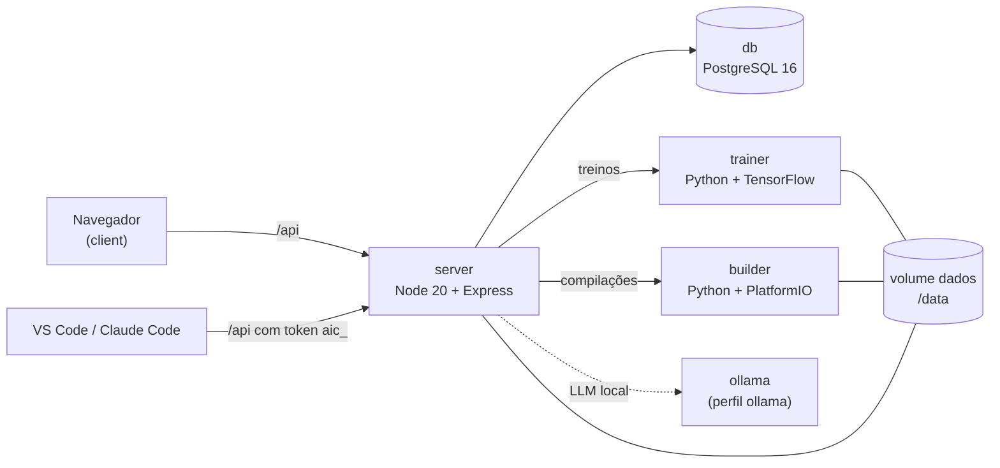

<p align="center"><strong>AI Creator</strong></p>

<p align="center">Crie, versione e execute agentes de IA e classificadores TinyML, e leve o firmware até a placa, em um único app web.</p>

<p align="center">
  
  
  
  
  
  
  
  
  
  
</p>

<!-- TODO: captura -->

## Sumário

- [Visão geral](#visão-geral)
- [Recursos](#recursos)
- [Placas suportadas](#placas-suportadas)
- [Arquitetura](#arquitetura)
- [Início rápido](#início-rápido)
- [Primeiro acesso](#primeiro-acesso)
- [Configuração](#configuração)
- [Integrações](#integrações)
- [Estrutura de pastas](#estrutura-de-pastas)
- [Desenvolvimento](#desenvolvimento)
- [Roadmap](#roadmap)
- [Contribuindo](#contribuindo)
- [Segurança](#segurança)
- [Licença](#licença)

## Visão geral

O AI Creator é uma plataforma web, instalada com Docker, para trabalhar com dois tipos de agente de IA e levar o resultado até o microcontrolador:

- **Agentes LLM**: um prompt de sistema, um modelo (Claude, OpenAI ou Ollama local), esforço ou temperatura e ferramentas. Dá para testar no playground com resposta em tempo real, guardar versões, exportar e importar no formato de subagente do Claude Code (`.claude/agents/*.md`).
- **Agentes TinyML**: um classificador para microcontrolador. Você envia um dataset em CSV, a plataforma treina um modelo, converte para TFLite INT8 e gera o `model_data.h`, pronto para entrar no firmware.

Sobre os agentes, o AI Creator também cuida do firmware: projetos PlatformIO (com editor de arquivos no navegador), compilação em um contêiner próprio, download do binário e gravação pelo navegador (Web Serial) ou pelo servidor, no Linux.

Quem trabalha no computador pode usar a extensão do VS Code e o servidor MCP com o plugin do Claude Code, que falam com a mesma API.

## Recursos

- **Agentes LLM**: provedores Claude, OpenAI e Ollama, playground com streaming (SSE), conversas salvas, uso de tokens por resposta.
- **Agentes TinyML**: formulário de configuração, treino em segundo plano, métricas, matriz de confusão e download do `.tflite` e do `model_data.h`.
- **Datasets e treinos**: importação de CSV com prévia, amostra, download e histórico de treinos.
- **Firmware**: projetos PlatformIO, editor de arquivos, compilações com log, dispositivos cadastrados, gravação por Web Serial ou pelo servidor.
- **VS Code**: árvore de agentes e projetos, baixar e enviar, compilar e gravar a placa pelo PlatformIO.
- **Claude Code e MCP**: ferramentas para listar e editar agentes e arquivos, compilar e treinar, além de comandos de plugin (`/ai-compilar`, `/ai-sincronizar-agentes`, `/ai-treinar`).
- **Usuários e acesso**: perfis ADMIN, DEV e LEITOR, tokens de API para integrações e registro de atividades.
- **Visual**: tema claro e escuro, painel com indicadores, uso no celular e instalação como app (PWA).

Os detalhes de cada parte estão em [docs/TINYML.md](docs/TINYML.md), [docs/FIRMWARE.md](docs/FIRMWARE.md) e [docs/INTEGRACOES.md](docs/INTEGRACOES.md).

## Placas suportadas

| Placa | Framework | Artefato gravado | Observação |
|---|---|---|---|
| ESP32 | Arduino | `firmware-merged.bin` | Gravação em `0x0` |
| ESP32-S3 | Arduino | `firmware-merged.bin` | Gravação em `0x0` |
| Arduino Nano 33 BLE | Arduino | `firmware.bin` | |
| Arduino Uno | Arduino | `firmware.hex` | |
| STM32 Nucleo F401RE | Arduino | `firmware.bin` | Gravação em `0x08000000` |
| Raspberry Pi Pico (RP2040) | Arduino | `firmware.uf2` | |

Os detalhes de cada placa, como offsets e gravação, estão em [docs/FIRMWARE.md](docs/FIRMWARE.md).

## Arquitetura

A plataforma roda em contêineres, orquestrados pelo `docker-compose.yml`:



| Serviço | Tecnologia | Função |
|---|---|---|
| `client` | React 18, Vite, nginx | Interface web, na porta `WEB_PORT` (padrão 8080) |
| `server` | Node 20, Express, Prisma | API HTTP, autenticação, agentes, projetos e filas |
| `trainer` | Python 3.11, FastAPI, TensorFlow | Treina os agentes TinyML e gera o TFLite |
| `builder` | Python 3.11, FastAPI, PlatformIO | Compila os projetos e grava as placas |
| `db` | PostgreSQL 16 | Dados da plataforma |
| `ollama` | Ollama | Modelos locais (só com o perfil `ollama`) |

Os detalhes estão em [docs/ARQUITETURA.md](docs/ARQUITETURA.md) e a lista de rotas em [docs/API.md](docs/API.md).

## Início rápido

Requisitos: **Docker Desktop** e, para baixar o projeto, o **Git**.

**Windows (PowerShell):**

```powershell
git clone https://github.com/marco3079/ai-creator.git
cd ai-creator
powershell -ExecutionPolicy Bypass -File .\instalar.ps1
```

**Linux e macOS (terminal):**

```bash
git clone https://github.com/marco3079/ai-creator.git
cd ai-creator
bash instalar.sh
```

O instalador confere o Docker, cria o arquivo `.env` com segredos aleatórios, pergunta (se quiser) as chaves de API, sobe os contêineres e mostra o endereço do site e o login do administrador. Use `--ollama` (Linux e macOS) ou `-Ollama` (Windows) para subir também o Ollama.

**Manual:**

```bash
cp .env.example .env        # troque POSTGRES_PASSWORD, JWT_SECRET e INTERNO_TOKEN
docker compose up -d --build
```

Para um passo a passo sem termos técnicos, veja [INSTALAR.md](INSTALAR.md).

### Instalar com um assistente de IA

Se você usa um assistente com acesso ao terminal (Claude Code ou outro), cole este texto nele:

> Instale o AI Creator do repositório https://github.com/marco3079/ai-creator neste computador seguindo o arquivo AGENTS.md do repositório. Ao terminar, me diga o endereço para abrir no navegador e o e-mail e a senha do administrador.

As instruções para o assistente estão em [AGENTS.md](AGENTS.md).

## Primeiro acesso

Na primeira subida, o sistema cria a conta do administrador com o e-mail de `ADMIN_EMAIL` e a senha de `ADMIN_SENHA`.

Os valores padrão são:

- **E-mail:** `admin@aicreator.local`
- **Senha:** `trocar123`

Entre no endereço do site (por padrão `http://localhost:8080`) e troque a senha em **Meu perfil** logo no primeiro acesso.

## Configuração

O arquivo `.env` na raiz é lido pelo Docker Compose. O instalador cria esse arquivo; para ajustar à mão, copie o `.env.example`.

| Variável | Padrão | Para que serve |
|---|---|---|
| `POSTGRES_PASSWORD` | `aicreator` | Senha do banco de dados |
| `JWT_SECRET` | `troque-este-segredo` | Segredo que assina os logins |
| `INTERNO_TOKEN` | `troque-token-interno` | Token que trainer e builder usam para chamar o servidor |
| `ADMIN_EMAIL` | `admin@aicreator.local` | E-mail da conta de administrador |
| `ADMIN_SENHA` | `trocar123` | Senha inicial do administrador |
| `ANTHROPIC_API_KEY` | vazio | Chave da API da Anthropic (agentes com provedor Claude) |
| `OPENAI_API_KEY` | vazio | Chave da API da OpenAI (agentes com provedor OpenAI) |
| `WEB_PORT` | `8080` | Porta do site no computador |

Os valores padrão servem para teste. O instalador gera segredos aleatórios no `.env`. Não envie o `.env` para o Git: ele já está no `.gitignore`.

Os agentes Ollama usam o modelo que estiver instalado no servidor Ollama local, que sobe com `--ollama` ou com `--profile ollama`.

## Integrações

- **VS Code**: extensão que mostra os agentes e projetos da plataforma e permite baixar, enviar, compilar e gravar a placa. Veja [docs/INTEGRACOES.md](docs/INTEGRACOES.md).
- **Claude Code**: servidor MCP e plugin, para listar e editar agentes e arquivos, compilar e treinar sem sair do chat. Veja [docs/INTEGRACOES.md](docs/INTEGRACOES.md). O modelo de configuração está em [.mcp.json.exemplo](.mcp.json.exemplo).
- **API HTTP**: qualquer cliente pode usar a API com um token de API (`aic_...`). Veja [docs/API.md](docs/API.md).

## Estrutura de pastas

```
ai-creator/
  docker-compose.yml          serviços, volumes e portas
  .env.example                modelo de configuração
  instalar.sh / instalar.ps1  instaladores (Linux/macOS e Windows)
  server/                     API (Node 20, TypeScript, Express, Prisma)
  client/                     interface web (React, TypeScript, Vite)
  trainer/                    treino TinyML (Python, FastAPI, TensorFlow)
  builder/                    compilação e gravação (Python, FastAPI, PlatformIO)
  extensions/vscode/          extensão do VS Code
  integrations/claude-code/   plugin e servidor MCP do Claude Code
  docs/                       documentação técnica
```

## Desenvolvimento

Para desenvolver sem os contêineres de aplicação, suba só o banco e rode o servidor e o cliente com Node.js 20:

```bash
# 1) banco (PostgreSQL publicado só em 127.0.0.1, na porta 5432)
docker compose up -d db

# 2) servidor
cd server
npm install
npm run dev

# 3) cliente
cd ../client
npm install
npm run dev
```

Com o cliente em modo de desenvolvimento, abra `http://localhost:5173`. O Vite encaminha `/api` para o servidor em `http://localhost:3333`.

Para o treino e a compilação, use o Compose só para os serviços de Python, com o servidor rodando à parte: `docker compose up -d --build trainer builder`. Lembre que o servidor local usa a porta 3333 e o `server` do Compose não é publicado.

Verificações antes de enviar uma mudança:

```bash
cd server && npx tsc --noEmit
cd client && npx tsc --noEmit && npm run build
docker compose config -q
```

## Roadmap

As próximas ideias, com prioridade (curto, médio e longo prazo), estão em [docs/SUGESTOES.md](docs/SUGESTOES.md).

## Contribuindo

Sugestões e correções são bem-vindas. Veja [CONTRIBUTING.md](CONTRIBUTING.md).

## Segurança

Para relatar uma vulnerabilidade, siga as instruções em [SECURITY.md](SECURITY.md).

## Licença

Este projeto é distribuído sob a licença MIT. Veja o arquivo [LICENSE](LICENSE).
