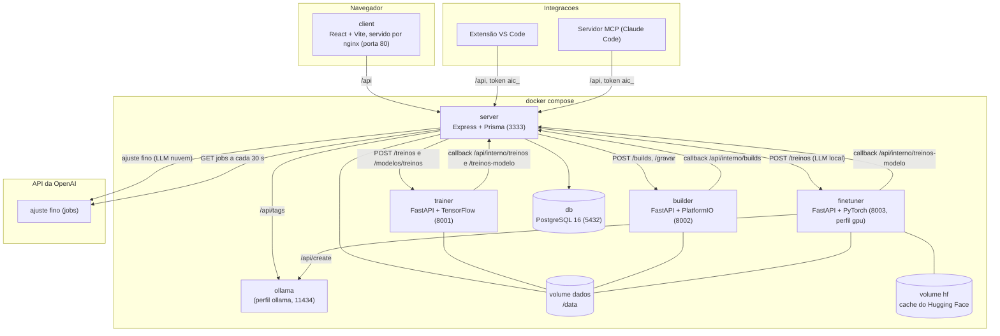
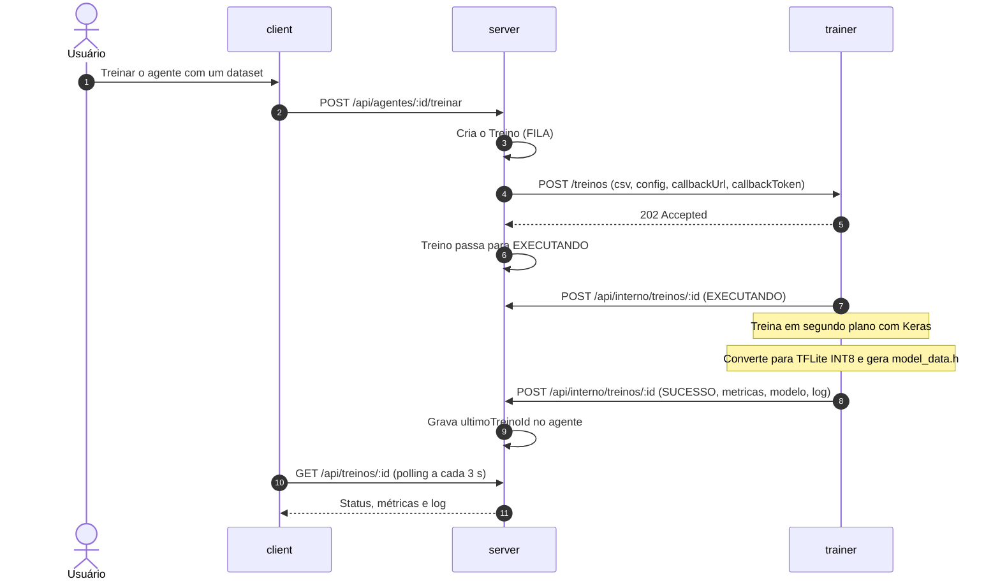
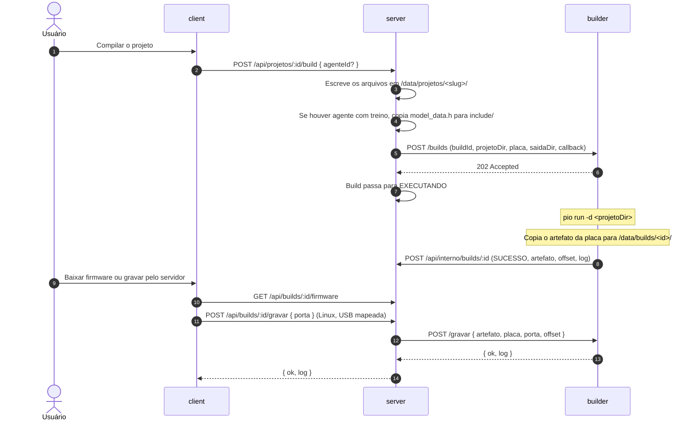
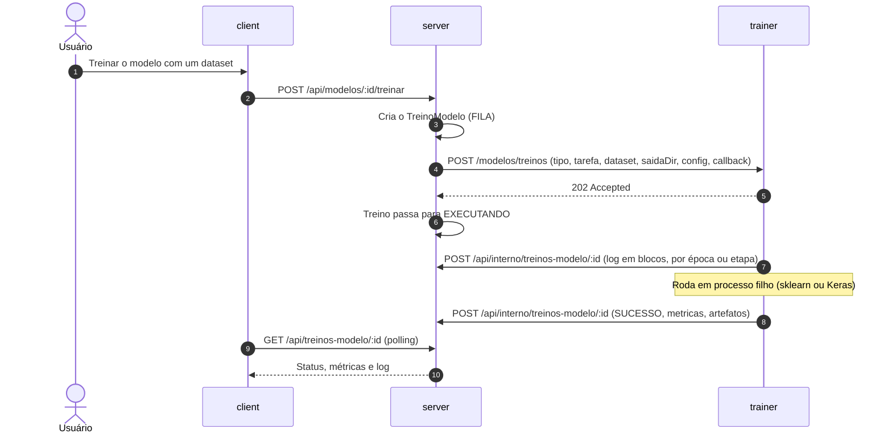
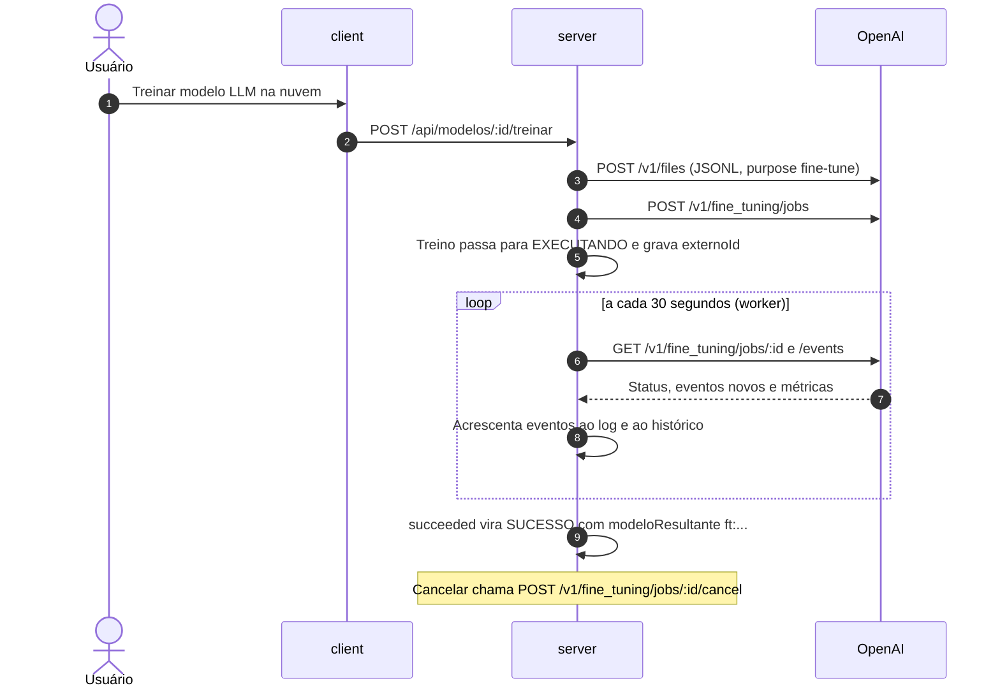
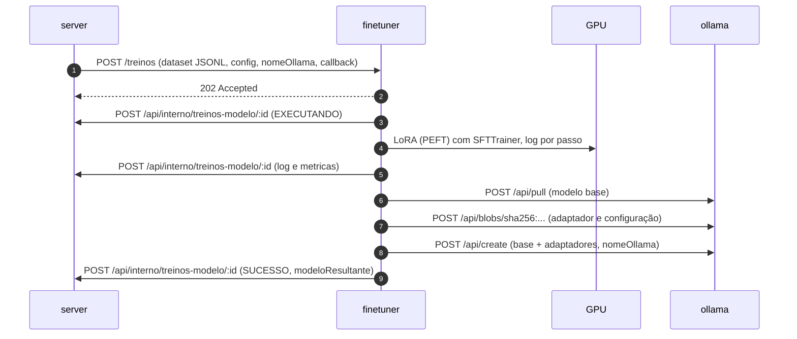

# Arquitetura

Este documento descreve os serviços da plataforma, os fluxos principais e as convenções de código. A lista de rotas está em [API.md](API.md).

## Serviços



| Serviço | Pasta | Tecnologia | Porta interna | Exposto no computador |
|---|---|---|---|---|
| `db` | (imagem) | PostgreSQL 16 | 5432 | não |
| `server` | `server/` | Node 20, Express 4, Prisma 5, TypeScript, `tsx` | 3333 | não |
| `client` | `client/` | React 18, Vite 5, TypeScript, nginx | 80 | sim, `WEB_PORT` (padrão 8080) |
| `trainer` | `trainer/` | Python 3.11, FastAPI, TensorFlow CPU, scikit-learn | 8001 | não |
| `builder` | `builder/` | Python 3.11, FastAPI, PlatformIO | 8002 | não |
| `finetuner` | `finetuner/` | Python 3.11, FastAPI, PyTorch CUDA, Transformers, PEFT, TRL | 8003 | não (perfil `gpu`, exige GPU NVIDIA) |
| `ollama` | (imagem `ollama/ollama`) | Ollama | 11434 | não (perfil `ollama`) |

Só o `client` é publicado. O `server` conversa com a extensão, com o MCP e com o navegador pelo `client`, que encaminha `/api`. Os serviços internos não têm porta publicada.

## Volumes

| Volume | Montado em | Quem usa | Conteúdo |
|---|---|---|---|
| `dados_db` | `/var/lib/postgresql/data` (db) | db | Dados do PostgreSQL |
| `dados` | `/data` | server, trainer, builder | Arquivos da plataforma |
| `platformio` | `/root/.platformio` | builder | Plataformas e bibliotecas do PlatformIO, para não baixar a cada compilação |
| `ollama` | `/root/.ollama` | ollama | Modelos locais |
| `hf` | `/root/.cache/huggingface` | finetuner | Modelos base baixados do Hugging Face, para não baixar a cada treino |

Dentro do volume `dados` (`/data`):

```
/data/
  datasets/<id>.csv                 CSV enviados
  datasets/<id>.jsonl               conversas enviadas (modelos LLM)
  datasets/<id>/                    imagens extraídas do .zip (datasets IMAGENS)
  treinos/<id>/                     modelo.tflite, model_data.h e log do treino (agentes TinyML)
  modelos/<modeloId>/treinos/<n>/   artefatos de cada treino de modelo (model.tflite, modelo.joblib, adapter_model.safetensors etc.)
  projetos/<slug>/                  arquivos do projeto PlatformIO
  builds/<id>/                      firmware gerado (firmware-merged.bin, firmware.bin etc.)
```

Os caminhos do servidor são relativos a `DATA_DIR`, que vale `/data` no Compose. Trainer e builder recebem só `DATA_DIR=/data`.

## Fluxo de treino TinyML



Se o treino falhar, o `trainer` envia `FALHA` com o log. O servidor não grava `ultimoTreinoId` nesse caso.

## Fluxo de compilação e gravação



A gravação pelo navegador (Web Serial) não passa pelo servidor. O detalhe está em [FIRMWARE.md](FIRMWARE.md).

## Fluxos de treino de modelos

A área **Modelos** tem três caminhos de treino, escolhidos pelo tipo do modelo. Em todos, o servidor cria um `TreinoModelo` (com um `numero` por modelo) e acompanha o resultado por callback.

### Treino TinyML e tabular (trainer)



Se o processo filho morrer sem enviar o callback final, o servidor grava FALHA com o motivo.

### Ajuste fino na OpenAI (worker)



O worker roda dentro do próprio servidor, com proteção contra execuções sobrepostas. Falhas de rede são registradas no log e não derrubam o servidor.

### Ajuste fino local (finetuner e Ollama)



Se o Ollama não responder, o treino termina em SUCESSO com um aviso no log e sem `modeloResultante`. Assim o adaptador continua disponível para baixar.

## Autenticação

Há dois tipos de credencial, aceitos no mesmo cabeçalho `Authorization: Bearer`:

- **JWT** (`jwt`): emitido no login, válido por 12 horas. O servidor recarrega o usuário no banco a cada requisição e recusa usuários inativos.
- **Token de API** (`aic_<40 hex>`): criado pelo usuário em **Tokens de API**. O servidor guarda só o hash SHA-256 e um prefixo para exibição. Um token revogado deixa de funcionar na hora. Quando usado, `ultimoUso` é atualizado.

O perfil (`ADMIN`, `DEV` ou `LEITOR`) define quais rotas a credencial pode usar. As rotas `/api/interno/*` usam outro segredo, `INTERNO_TOKEN`, enviado no cabeçalho `X-Interno-Token`.

Senhas são guardadas com bcrypt.

## Convenção de módulos

### Servidor

- Cada módulo fica em `server/src/modules/<modulo>/routes.ts` e exporta `export default router` (um `express.Router()`).
- As rotas são declaradas com o caminho completo, sem `/api` (por exemplo, `router.get('/agentes', ...)`).
- Na inicialização, `app.ts` lê a pasta `src/modules` e monta cada `router` em `/api`. Para criar um módulo, basta criar a pasta com o `routes.ts`.
- Código comum fica em `server/src/lib/`: `prisma.ts`, `config.ts`, `erros.ts` (classe `ErroHttp` e o wrapper `rota`), `auth.ts` (autenticação e perfis), `log.ts` (registro de atividades), `slug.ts` e `arquivos.ts`.
- Validação de entrada com zod. Erros são convertidos pelo tratador de `app.ts`: `ErroHttp` vira o status informado, erro de validação vira `400` com a primeira mensagem, e o resto vira `500 "Erro interno"`.

### Cliente

- Cada módulo fica em `client/src/modules/<modulo>/index.tsx` e exporta `export const rotas: RotaModulo[]`. O `App.tsx` junta os módulos com `import.meta.glob`.
- Componentes visuais ficam em `client/src/ui/index.tsx`, e o menu de ações em `client/src/ui/MenuAcoes.tsx`.
- Os tipos compartilhados com a API ficam em `client/src/lib/tipos-api.ts`.
- Chamadas HTTP passam por `api.get/post/put/del` e por `useDados<T>(caminho)`. Para SSE, use `lerEventos` de `client/src/lib/sse.ts`.
- Cores só por variáveis CSS do tema.

## Banco de dados

O esquema fica em `server/prisma/schema.prisma`. Ao subir, o servidor aplica o esquema com `prisma db push` e roda o seed, que cria o administrador. A configuração de cada agente TinyML é guardada como JSON no campo `configTinyml` (formato em [TINYML.md](TINYML.md)).

Cada alteração de agente gera uma linha em `VersaoAgente` com o snapshot completo. Por isso o histórico de versões funciona sem tabela de diferenças.

## Serviços externos

- **Anthropic**: SDK oficial, com a chave `ANTHROPIC_API_KEY`.
- **OpenAI**: chave `OPENAI_API_KEY`.
- **Ollama**: `OLLAMA_URL` (padrão `http://ollama:11434`). Os modelos são listados em `/api/tags`.
- **PlatformIO**: dentro do `builder`, com o registro de plataformas no volume `platformio`.

Se um provedor não tiver chave ou não responder, a API devolve erro em português e a interface mostra o aviso, sem derrubar o restante do sistema.
