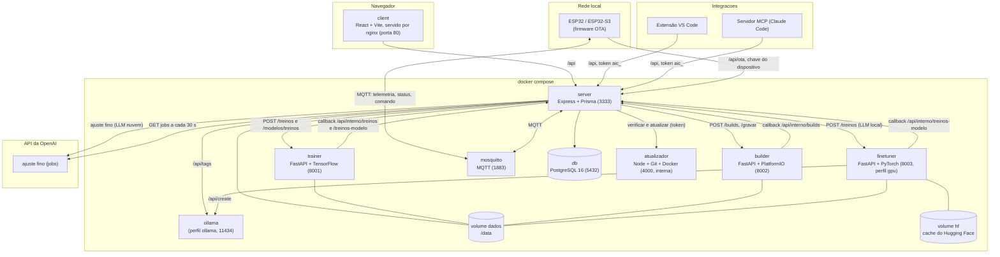
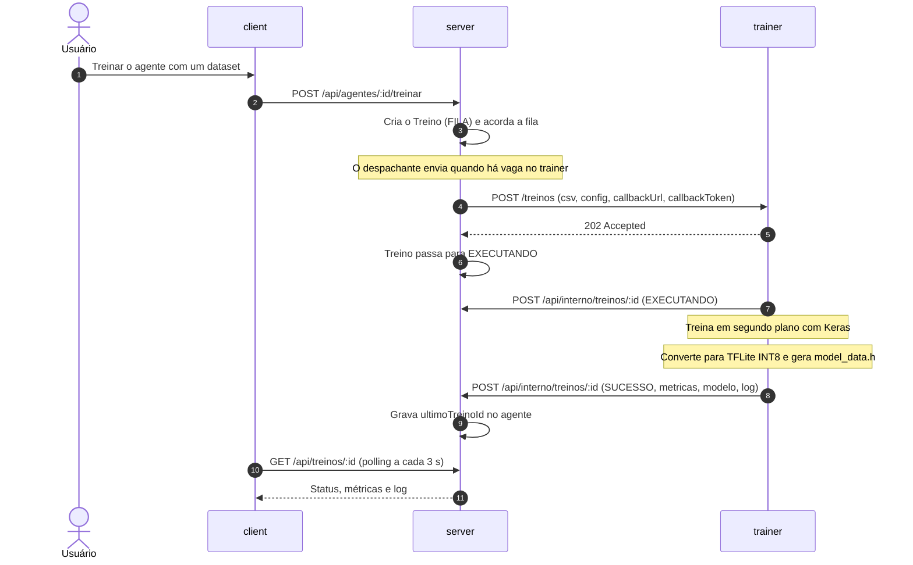
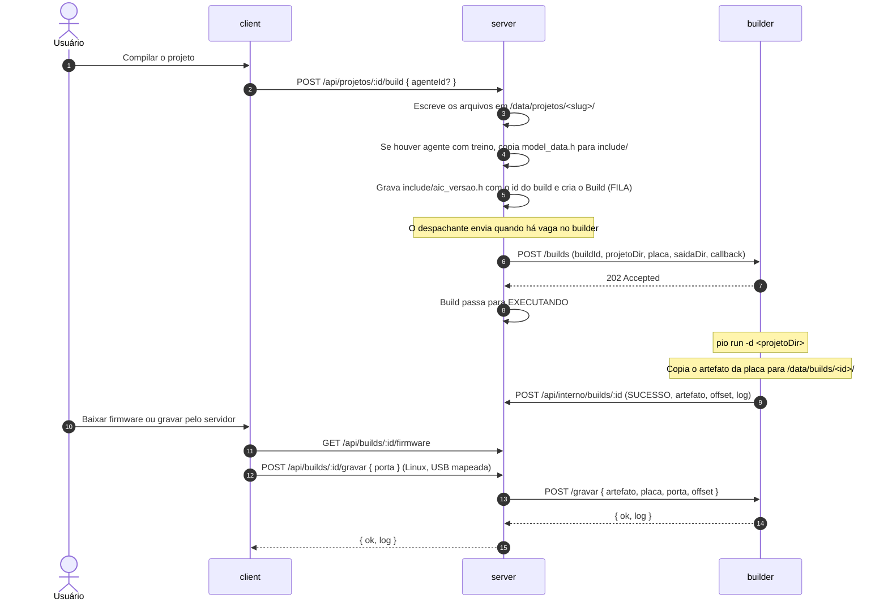
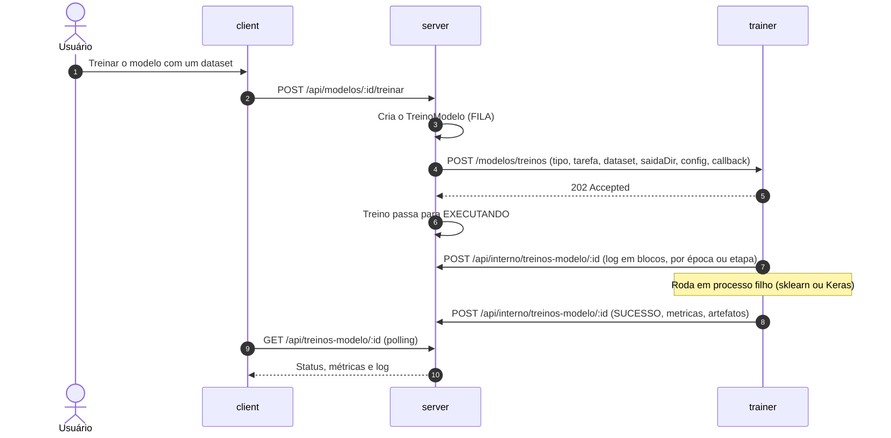
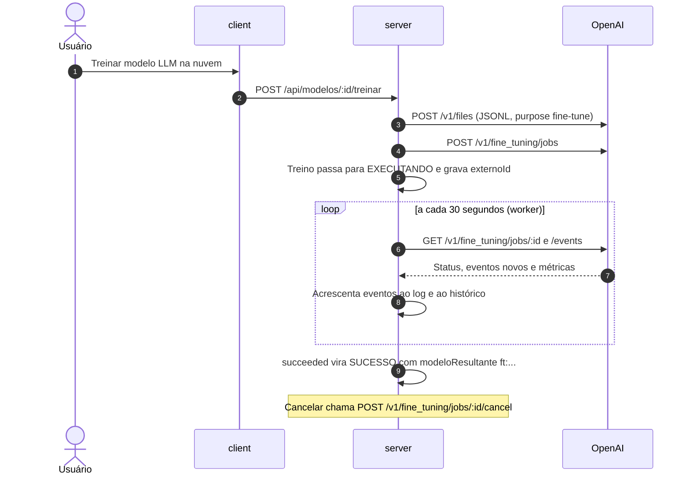
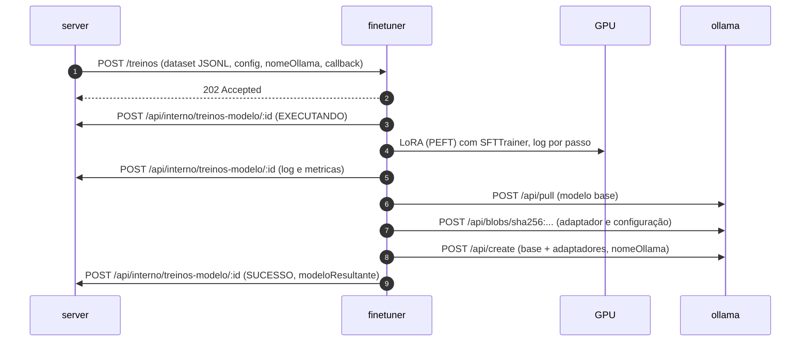
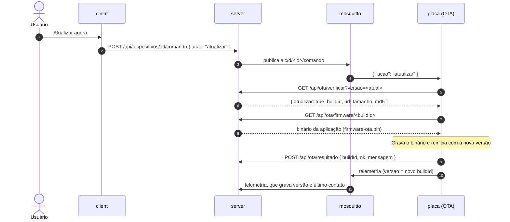

# Arquitetura

Este documento descreve os serviços da plataforma, os fluxos principais e as convenções de código. A lista de rotas está em [API.md](API.md).

## Serviços



| Serviço | Pasta | Tecnologia | Porta interna | Exposto no computador |
|---|---|---|---|---|
| `db` | (imagem) | PostgreSQL 16 | 5432 | não |
| `server` | `server/` | Node 20, Express 4, Prisma 5, TypeScript, `tsx` | 3333 | não |
| `client` | `client/` | React 18, Vite 5, TypeScript, nginx | 80 | sim, `WEB_PORT` (padrão 8080) |
| `trainer` | `trainer/` | Python 3.11, FastAPI, TensorFlow CPU, scikit-learn | 8001 | não |
| `builder` | `builder/` | Python 3.11, FastAPI, PlatformIO | 8002 | não |
| `finetuner` | `finetuner/` | Python 3.11, FastAPI, PyTorch CUDA, Transformers, PEFT, TRL | 8003 | não (perfil `gpu`, exige GPU NVIDIA) |
| `ollama` | (imagem `ollama/ollama`) | Ollama | 11434 | não (perfil `ollama`) |
| `mosquitto` | `mosquitto/` (imagem sobre `eclipse-mosquitto:2.0.20`) | Broker MQTT da frota | 1883 | sim, `MQTT_PORTA` (1883), para as placas da rede local |
| `atualizador` | `atualizador/` | Node, Git e Docker CLI; baixa a versão nova e reconstrói o que mudou | 4000 | não (só o `server` acessa, pela rede interna) |

O `client` é publicado para o navegador, e o `mosquitto` para as placas da rede local. O `server` conversa com a extensão, com o MCP e com o navegador pelo `client`, que encaminha `/api`. Os demais serviços internos não têm porta publicada.

## Volumes

| Volume | Montado em | Quem usa | Conteúdo |
|---|---|---|---|
| `dados_db` | `/var/lib/postgresql/data` (db) | db | Dados do PostgreSQL |
| `dados` | `/data` (e `/servidor`, só leitura, no atualizador) | server, trainer, builder, atualizador (só leitura) | Arquivos da plataforma |
| `platformio` | `/root/.platformio` | builder | Plataformas e bibliotecas do PlatformIO, para não baixar a cada compilação |
| `ollama` | `/root/.ollama` | ollama | Modelos locais |
| `hf` | `/root/.cache/huggingface` | finetuner | Modelos base baixados do Hugging Face, para não baixar a cada treino |
| `mosquitto` | `/mosquitto/data` | mosquitto | Dados do broker, como as mensagens retidas do status das placas |
| `atualizador` | `/dados` | atualizador | Estado da atualização: `tarefa.json`, `implantado`, versão e cópias do banco (o banco em si fica em `backups/`, na pasta do projeto) |

Dentro do volume `dados` (`/data`):

```
/data/
  datasets/<id>.csv                 CSV enviados
  datasets/<id>.jsonl               conversas enviadas (modelos LLM)
  datasets/<id>/                    imagens extraídas do .zip (datasets IMAGENS)
  treinos/<id>/                     modelo.tflite, model_data.h e log do treino (agentes TinyML)
  modelos/<modeloId>/treinos/<n>/   artefatos de cada treino de modelo (model.tflite, modelo.joblib, adapter_model.safetensors etc.)
  projetos/<slug>/                  arquivos do projeto PlatformIO
  builds/<id>/                      firmware gerado (firmware-merged.bin, firmware.bin etc.)
```

Os caminhos do servidor são relativos a `DATA_DIR`, que vale `/data` no Compose. Trainer e builder recebem só `DATA_DIR=/data`.

## Fluxo de treino TinyML



Se o treino falhar, o `trainer` envia `FALHA` com o log. O servidor não grava `ultimoTreinoId` nesse caso.

## Fluxo de compilação e gravação



A gravação pelo navegador (Web Serial) não passa pelo servidor. O detalhe está em [FIRMWARE.md](FIRMWARE.md).

## Fluxos de treino de modelos

A área **Modelos** tem três caminhos de treino, escolhidos pelo tipo do modelo. Em todos, o servidor cria um `TreinoModelo` (com um `numero` por modelo) e acompanha o resultado por callback.

### Treino TinyML e tabular (trainer)



Se o processo filho morrer sem enviar o callback final, o servidor grava FALHA com o motivo.

### Ajuste fino na OpenAI (worker)



O worker roda dentro do próprio servidor, com proteção contra execuções sobrepostas. Falhas de rede são registradas no log e não derrubam o servidor.

### Ajuste fino local (finetuner e Ollama)



Se o Ollama não responder, o treino termina em SUCESSO com um aviso no log e sem `modeloResultante`. Assim o adaptador continua disponível para baixar.

## Fila de trabalhos e vigia

Treinos e compilações não são enviados no momento do clique. Cada pedido vira uma linha em `FILA` no PostgreSQL, e o despachante do `server` envia o trabalho quando o serviço tem vaga. Assim, um pedido não se perde se o `server` reiniciar.

Estados: `FILA` → `EXECUTANDO` → `SUCESSO`, `FALHA` ou `CANCELADO`.

**Despachante** (`server/src/modules/fila/despachante.ts`)

- Roda a cada 3 segundos e também logo que um pedido chega (`acordarFila`), sem sobrepor dois ciclos.
- Vagas por serviço: `trainer` (variável `FILA_TRAINER`, padrão 1), `builder` (`FILA_BUILDER`, padrão 2), `finetuner` (`FILA_FINETUNER`, padrão 1) e OpenAI (5, fixo).
- Cada trabalho passa de `FILA` para `EXECUTANDO` com uma atualização que só vale se ele ainda estiver em `FILA`. Assim dois ciclos não pegam o mesmo trabalho.
- Serviço fora do ar (falha de conexão, timeout ou erro 5xx): o trabalho volta para `FILA` com uma tentativa a mais e só é reenviado 15 segundos depois. Ao chegar a 20 tentativas, vira `FALHA`. Erro 4xx do serviço vira `FALHA` na hora, com o corpo da resposta no log.

**Vigia** (`server/src/modules/fila/vigia.ts`)

- Roda 10 segundos depois de subir e depois a cada 60 segundos.
- Pergunta a cada serviço quais trabalhos ainda executam (`GET /trabalhos`). Um trabalho `EXECUTANDO` que não aparece lá, há mais de 2 minutos, é marcado como `FALHA`, porque o serviço reiniciou e o trabalho se perdeu.
- Tempo limite, contado desde o início: build 30 minutos, treino no `trainer` 2 horas e ajuste fino local 12 horas. Os jobs de LLM na nuvem são acompanhados pelo worker da OpenAI.
- Em testes, `FILA_DESLIGADA=1` desliga o despachante e a vigia.

`GET /api/fila` mostra, por serviço, a capacidade, quantos executam, quantos esperam e se o serviço responde.

## Eventos ao vivo

Toda mudança de status ou de log de um trabalho vira um evento (`emitirEvento` em `server/src/lib/eventos.ts`). As telas recebem esses eventos por SSE em `GET /api/eventos`.

- Cada evento de trabalho é um JSON `EventoTrabalho`, com `tipo` (`treino`, `treinoModelo` ou `build`), `id`, `status`, `em` e o id do agente, do modelo ou do projeto. Um `: ping` sai a cada 25 segundos para a conexão não cair no proxy.
- Os eventos da frota têm `tipo: 'dispositivo'` e o corpo `{ tipo, id, online, statusOta, em }`, sem `status`.
- No cliente, há **uma** conexão compartilhada (`client/src/lib/eventos.ts`). Ela só fica aberta enquanto alguma tela está assinando, e reconecta com espera de 1, 2, 5 e 10 segundos. As telas recarregam os dados quando chega um evento que interessa, e mantêm um polling de segurança a cada 20 segundos.

## Frota e OTA

Placas ESP32 e ESP32-S3 com o modelo de projeto OTA conversam com o servidor de dois jeitos:

- **MQTT** (broker `mosquitto`, `allow_anonymous false`, com usuário e senha): tópicos `aic/d/<dispositivoId>/` com `telemetria` (da placa para o servidor), `status` (retido: `online`, ou `offline` pelo Last Will) e `comando` (do servidor para a placa, `atualizar` ou `reiniciar`).
- **HTTP** em `/api/ota/*`, com os cabeçalhos `X-Dispositivo-Id` e `X-Dispositivo-Chave` (sem JWT): a placa consulta se há build novo, baixa o binário e informa o resultado.

O servidor (`server/src/modules/frota/mqtt.ts`) usa o cliente `mqtt` e a variável `MQTT_URL` (padrão `mqtt://mosquitto:1883`). Sem broker, o servidor segue funcionando e só registra o problema no log. Ao receber telemetria, ele marca a placa como online, grava o último contato, a telemetria e a versão em execução, e guarda uma amostra no máximo a cada 30 segundos (amostras com mais de 7 dias são apagadas todo dia). Sem contato por 60 segundos, a placa vira offline. Cada mudança de online, telemetria ou status da OTA emite um evento `dispositivo`, e a tela da frota atualiza ao vivo.



Os binários entram pela mesma fila de compilação. O build de uma placa OTA gera também o `firmware-ota.bin`, e só esse arquivo vai para a placa. O alvo de cada placa é definido na tela da frota, e só builds SUCESSO da mesma placa podem ser alvo.

## Atualizador

O botão **Atualizar agora** (Sistema > Atualização, só ADMIN) baixa a versão nova do GitHub e reconstrói só o que mudou. Quem faz o trabalho é o contêiner `atualizador` (pasta `atualizador/`), porque o `server` não consegue baixar código nem chamar o Docker. O serviço não publica porta: só o `server` fala com ele, pela rede interna (`ATUALIZADOR_URL`, padrão `http://atualizador:4000`).

- **Imagem e montagens**: Node, Git e Docker CLI. A pasta do projeto entra em `/projeto` (com o `.git`), o soquete do Docker em `/var/run/docker.sock`, o volume `dados` em `/servidor` só para leitura e o volume `atualizador` em `/dados`. O banco não é acessado direto: a cópia é feita com `docker compose exec db pg_dump`.
- **Token**: o cabeçalho `X-Atualizador-Token` leva `sha256('atualizador:' + JWT_SECRET)`. O `server` calcula com o segredo efetivo (`config.jwtSegredo`, que pode vir de `dados/segredos.json`). O atualizador usa o `JWT_SECRET` do ambiente, a não ser que seja o valor de exemplo; nesse caso lê o segredo de `/servidor/segredos.json`. Sem segredo, todo pedido recebe 401. `GET /saude` não pede token e é o healthcheck.
- **Consulta**: `GET /estado` devolve a versão instalada (`implantado`), a última do GitHub, as novidades, a lista `servicos` que seriam reconstruídos e as `copias` em `backups/`. Com `?verificar=1` antes faz `git fetch --prune`. A tela verifica ao abrir, em segundo plano na subida (após 60 segundos) e a cada 6 horas.
- **Serviços que serão reconstruídos**: o atualizador compara `git diff --name-only <implantado>..<remoto>` e aplica o mapa abaixo.

| Arquivos que mudaram | Serviços reconstruídos |
|---|---|
| `server/` | `server` (build e up) |
| `client/` | `client` (build e up) |
| `trainer/` | `trainer` (build e up) |
| `builder/` | `builder` (build e up) |
| `finetuner/` | `finetuner` (build e up), só se estiver rodando (perfil `gpu`) |
| `mosquitto/` | `mosquitto` (build e up; a imagem é própria, em `mosquitto/Dockerfile`) |
| `docker-compose.yml` | todos os serviços rodando, menos `atualizador` e `db` (só up, sem build) |
| `atualizador/` | nada; a tela só avisa que o atualizador mudou |
| outros (`docs/`, `README.md`, `extensions/`, `mcp/`, `e2e/`, `exemplos/`...) | nada |

Os serviços que o atualizador reconstrói não podem ter bind mount. O Compose roda de dentro do contêiner `atualizador`, e um caminho relativo (`./arquivo:/destino`) não existe no computador, porque o daemon do Docker do host o resolve sozinho. Por isso o `mosquitto` tem imagem própria, com a configuração e a entrada copiadas para dentro dela. O próprio `atualizador` tem bind mounts, mas nunca é reconstruído pela tela.

Se o commit instalado for desconhecido (sem registro, ou que não existe mais no repositório), o atualizador reconstrói `server client trainer builder`, mais `finetuner` se estiver rodando.

- **Sequência de uma atualização** (`POST /atualizar`, 202; 409 se já houver uma tarefa `EXECUTANDO`):
  1. **Copiando o banco**: `pg_dump` pelo `docker compose exec -T db`, gravado em `backups/aicreator-AAAAMMDD-HHMMSS.sql` (escreve num `.parcial` e renomeia no fim). Se o comando falhar ou o arquivo vier vazio, a tarefa para aqui, antes de baixar o código. Ficam só as 5 cópias mais recentes.
  2. **Baixando o código**: `git fetch --prune` e `git pull --ff-only origin <ramo>`. O atualizador nunca usa `reset`, `clean`, `stash` nem `checkout` de arquivos.
  3. **Reconstruindo**: `docker compose build` só com os serviços da lista. Se a lista estiver vazia, a etapa é pulada com a mensagem "Nenhum serviço precisou ser reconstruído".
  4. **Reiniciando**: `docker compose up -d --no-deps` com os mesmos serviços.
  
  No fim, grava `implantado` com o commit HEAD. A tarefa é única e o log guarda até 200 linhas de até 500 caracteres. O estado fica em `/dados/tarefa.json`.
- **Por que o atualizador não se reconstrói**: ele é quem reconstrói os outros serviços, e reconstruir a si mesmo no meio da tarefa derrubaria o próprio processo. Se os arquivos dele mudarem, a tela avisa; para pegar a mudança, rode `docker compose up -d --build atualizador`.
- **Registro do `implantado`**: os instaladores (`instalar.sh` e `instalar.ps1`) e os scripts `atualizar.sh` e `atualizar.ps1` gravam o commit instalado com `git rev-parse HEAD`, para a tela comparar com o GitHub. Numa pasta sem Git, a atualização pelo painel não funciona.

## Autenticação

Há dois tipos de credencial, aceitos no mesmo cabeçalho `Authorization: Bearer`:

- **JWT** (`jwt`): emitido no login, válido por 12 horas. O servidor recarrega o usuário no banco a cada requisição e recusa usuários inativos.
- **Token de API** (`aic_<40 hex>`): criado pelo usuário em **Tokens de API**. O servidor guarda só o hash SHA-256 e um prefixo para exibição. Um token revogado deixa de funcionar na hora. Quando usado, `ultimoUso` é atualizado.

O perfil (`ADMIN`, `DEV` ou `LEITOR`) define quais rotas a credencial pode usar. As rotas `/api/interno/*` usam outro segredo, `INTERNO_TOKEN`, enviado no cabeçalho `X-Interno-Token`.

Uma placa da frota não usa login: as rotas `/api/ota/*` pedem `X-Dispositivo-Id` e `X-Dispositivo-Chave`. A chave tem o formato `aicd_<40 hex>`, e o servidor guarda só o hash SHA-256.

Senhas são guardadas com bcrypt. Quando o usuário precisa trocar a senha (a senha padrão do administrador, ou uma senha redefinida por outro administrador), o login e `GET /api/auth/eu` devolvem `trocarSenha: true`, e a tela só libera as outras páginas depois da troca (`POST /api/auth/trocar-senha`).

Os segredos `JWT_SECRET` e `INTERNO_TOKEN`, quando ficam com o valor de exemplo, são gerados pelo servidor e gravados em `DATA_DIR/segredos.json`, com permissão restrita. Veja [SECURITY.md](../SECURITY.md).

## Convenção de módulos

### Servidor

- Cada módulo fica em `server/src/modules/<modulo>/routes.ts` e exporta `export default router` (um `express.Router()`).
- As rotas são declaradas com o caminho completo, sem `/api` (por exemplo, `router.get('/agentes', ...)`).
- Na inicialização, `app.ts` lê a pasta `src/modules` e monta cada `router` em `/api`. Para criar um módulo, basta criar a pasta com o `routes.ts`.
- Código comum fica em `server/src/lib/`: `prisma.ts`, `config.ts`, `erros.ts` (classe `ErroHttp` e o wrapper `rota`), `auth.ts` (autenticação e perfis), `log.ts` (registro de atividades), `slug.ts`, `arquivos.ts`, `eventos.ts` (eventos ao vivo) e `segredos.ts` (segredos persistentes).
- Validação de entrada com zod. Erros são convertidos pelo tratador de `app.ts`: `ErroHttp` vira o status informado, erro de validação vira `400` com a primeira mensagem, e o resto vira `500 "Erro interno"`.

### Cliente

- Cada módulo fica em `client/src/modules/<modulo>/index.tsx` e exporta `export const rotas: RotaModulo[]`. O `App.tsx` junta os módulos com `import.meta.glob`.
- Componentes visuais ficam em `client/src/ui/index.tsx`, e o menu de ações em `client/src/ui/MenuAcoes.tsx`.
- Os tipos compartilhados com a API ficam em `client/src/lib/tipos-api.ts`.
- Chamadas HTTP passam por `api.get/post/put/del` e por `useDados<T>(caminho)`. Para SSE, use `lerEventos` de `client/src/lib/sse.ts`.
- Cores só por variáveis CSS do tema.

## Banco de dados

O esquema fica em `server/prisma/schema.prisma`. Ao subir, o servidor aplica o esquema com `prisma db push` e roda o seed, que cria o administrador. A configuração de cada agente TinyML é guardada como JSON no campo `configTinyml` (formato em [TINYML.md](TINYML.md)).

Cada alteração de agente gera uma linha em `VersaoAgente` com o snapshot completo. Por isso o histórico de versões funciona sem tabela de diferenças.

## Serviços externos

- **Anthropic**: SDK oficial, com a chave `ANTHROPIC_API_KEY`.
- **OpenAI**: chave `OPENAI_API_KEY`.
- **Ollama**: `OLLAMA_URL` (padrão `http://ollama:11434`). Os modelos são listados em `/api/tags`.
- **PlatformIO**: dentro do `builder`, com o registro de plataformas no volume `platformio`.
- **MQTT**: broker `mosquitto`, com `MQTT_URL` no servidor e usuário e senha (`MQTT_USUARIO` e `MQTT_SENHA`). Usado pela frota (veja [Frota e OTA](#frota-e-ota)).

Se um provedor não tiver chave ou não responder, a API devolve erro em português e a interface mostra o aviso, sem derrubar o restante do sistema.
